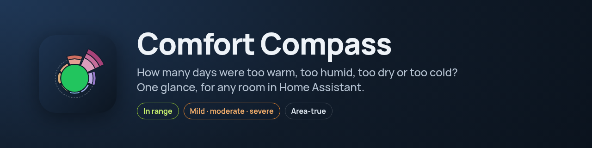
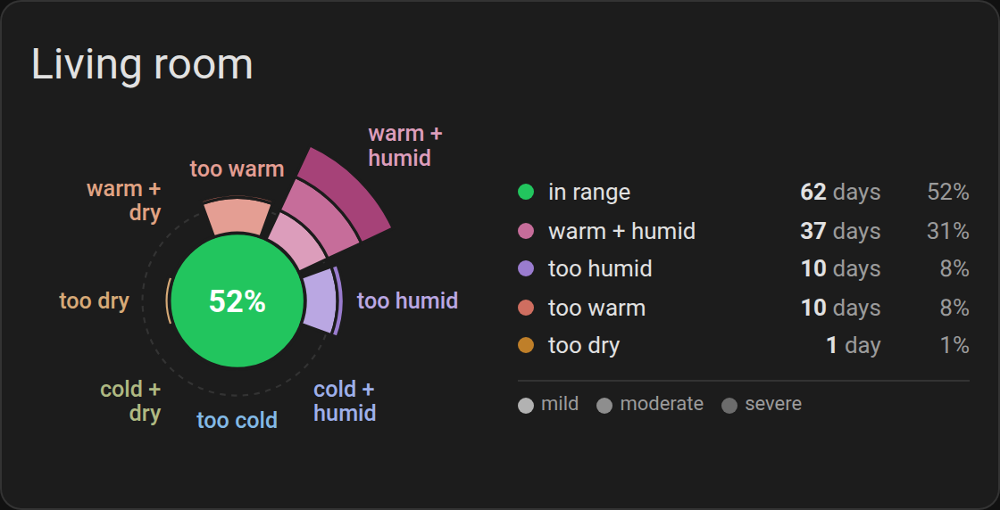
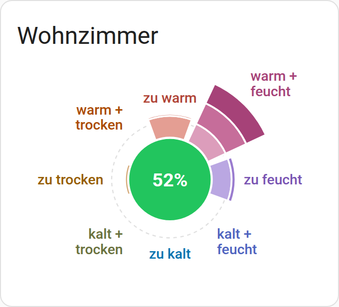

<p align="center">
  
</p>

<p align="center">
  <a href="https://github.com/retomarek/comfort-compass-card/releases"></a>
  <a href="https://github.com/hacs/integration"></a>
  
  <a href="https://github.com/retomarek/comfort-compass-card/actions/workflows/validate.yaml"></a>
  <a href="https://github.com/retomarek/comfort-compass-card/releases"></a>
  <a href="LICENSE"></a>
</p>

<p align="center">
  <a href="https://my.home-assistant.io/redirect/hacs_repository/?owner=retomarek&repository=comfort-compass-card&category=plugin"></a>
</p>

<p align="center">
  
  
</p>

The card takes the daily means of a temperature and a humidity sensor and compares every day with your comfort zone. The dashed circle stands for all days. The green disc is the share of days in range; each of the eight arms is the share of days that were off in one direction: too warm, too humid, too dry, too cold, or a mix of two. Disc and arms together always have the area of the dashed circle. Each arm is split into mild, moderate and severe, from the inside out.

> **Built on [pyedautils](https://github.com/retomarek/pyedautils)**, the *Python Energy Data Analysis Utilities*: a pip-installable library (`pip install pyedautils`) for analysing and visualising energy and comfort time series. The compass is a port of its `comfort_compass_distribution()` and `plot_comfort_compass()`, so you can take the same sensor data into Python or Jupyter for deeper analysis.

## Why temperature and humidity belong together

Comfort, health and the risk of mould always depend on temperature **and** humidity at the same time. Looking at one of them alone, or at two separate graphs, can easily mislead:

- **Relative humidity changes with temperature.** Air at 21 °C and 60 % holds about 9.3 g of water per kg. Warm the same air to 26 °C and it reads only 44 %; cool it at a 15 °C outer wall and it reaches about 87 %, enough for mould. The amount of water did not change at all.
- **The same reading means different things.** 23 °C feels pleasant at 45 %, but sticky at 70 %.

That is why the compass judges every day on both together: a day only counts as *in range* when temperature and humidity are both in the comfort zone, and the direction of an arm tells you which combination was off. *Warm + humid* calls for cooling or ventilation, *cold + humid* points to condensation and mould risk, *warm + dry* to overheated, dry winter air.

## Good for people and the environment

The h,x diagram behind this card explains why the compass looks the way it does, and what you can do about it:

- **Too dry in winter** (left arms) usually comes from ventilating with cold outside air: at 0 °C and 80 % it carries only about 3.2 g/kg of water, which is just **20 %** relative humidity once heated to 21 °C.
- **Heating less** moves days towards *in range*: the water content stays, the relative humidity rises. Air with 6.4 g/kg reads about 35 % at 23 °C, but 40 % at 21 °C. As a rule of thumb, every degree less saves around **6 % of heating energy**, good for comfort, the bill and the climate.
- **Too humid or cold + humid** (right and lower right arms) means a risk of condensation and mould at cold surfaces: at 21 °C and 60 %, the dew point is 12.9 °C, and mould can grow on surfaces below about 16 °C, such as outside wall corners in winter. Short, wide-open airing helps, as long as the outside air is drier than the room air.

The [Mollier hx Card README](https://github.com/retomarek/mollier-hx-card#the-hx-diagram-in-five-minutes) explains the h,x diagram step by step, with these examples. The two cards work well side by side: the diagram shows *where* each day was, the compass *how often*.

## Features

- **Area-true**: the disc and the arms together always cover exactly the area of the dashed circle, which stands for 100 % of the days. Every area is proportional to its number of days, so the picture does not exaggerate.
- **Reads like an h,x diagram**: warm at the top, cold at the bottom, humid on the right, dry on the left.
- **Severity from warning bands**: mild means inside the orange band, moderate inside the red band, severe beyond it. Relative **and** absolute humidity count.
- **Hover or tap** a segment for its days, share and severity split. A legend is optional.
- **Fits any dashboard**: the glyph is capped in size and centred, so it stays tidy at full width and fills a tile with a fixed height.
- **Follows your theme**, light or dark, and your Home Assistant language (14 languages, see [Translations](#translations)).
- **Visual editor** with entity pickers limited to sensors that have long-term statistics.
- Pairs with the [Mollier hx Card](https://github.com/retomarek/mollier-hx-card), which uses the same comfort zone and warning bands.

## Requirements

Both sensors need long-term statistics, which means `state_class: measurement`. Most temperature and humidity sensors already have it. The visual editor only lists sensors that qualify.

## Installation

From Home Assistant 2026.11 on, community cards come from the built-in **Marketplace** (*Settings → Marketplace*). On older versions use **HACS**. Both use the same catalog.

1. Open the link above, or search for **Comfort Compass Card**.
   - Not listed yet? Marketplace: *Add from link* with `https://github.com/retomarek/comfort-compass-card`. HACS: three-dot menu → *Custom repositories*, type *Dashboard*.
2. Install it. The dashboard resource is added for you.
3. Reload the browser.

## Configuration

Add a card, pick **Comfort compass card** and fill in the form. Or use YAML:

```yaml
type: custom:comfort-compass-card
temperature_entity: sensor.living_room_temperature
humidity_entity: sensor.living_room_humidity
header: Living room
days: 90
```

### Options

| Option | Type | Default | Description |
| --- | --- | --- | --- |
| `temperature_entity` | string | | **Required.** Temperature sensor. |
| `humidity_entity` | string | | **Required.** Relative-humidity sensor. Values in 0..1 or 0..100 are detected. |
| `header` | string | | Card title. |
| `days` | number | `30` | Days to count. The recorder keeps long-term statistics for a year by default. |
| `comfort_zone` | object | 20–26 °C, 30–60 %, 0–12 g/kg | See below. |
| `warning_bands` | object | see below | Limits for mild and moderate. |
| `altitude` | number | | Altitude in m above sea level, for the absolute humidity. Overrides `pressure`. |
| `pressure` | number | `101325` | Air pressure in Pa. |
| `show_legend` | boolean | `false` | List the directions with days and share. Beside the compass when the card is wide, below it otherwise. |
| `show_labels` | boolean | `true` | Name the eight directions around the compass. |
| `scale` | string | `fit` | `fit` zooms to this compass so it fills the card. `fixed` keeps the dashed 100 % circle the same size in every card, so several rooms can be compared by area. See [Comparing rooms](#comparing-rooms). |

#### `comfort_zone`

```yaml
comfort_zone:
  temperature: [20, 26]        # °C
  humidity: [30, 60]           # % relative humidity
  absolute_humidity: [0, 12]   # g/kg
```

A day is *in range* when all three hold. A humid day is one above the relative **or** the absolute limit, so a warm day above 12 g/kg counts as warm and humid even if its relative humidity is fine.

#### `warning_bands`

± offsets around the comfort zone that separate the severity stages: temperature in K, relative humidity in %-points, absolute humidity in g/kg.

```yaml
warning_bands:
  orange: { temperature: 1, humidity: 5, absolute_humidity: 1 }        # mild up to here
  red: { temperature: 2.5, humidity: 10, absolute_humidity: 2.5 }      # moderate up to here, severe beyond
```

These are the defaults. The worse of temperature and humidity decides the stage. The [Mollier hx Card](https://github.com/retomarek/mollier-hx-card) takes the same `comfort_zone` and `warning_bands` and draws them as zone and dashed bands.

### Reading the compass

The dashed circle is the area of **100 % of the days**. The green disc and the arms always add up to exactly that area:

- All days in range: the green disc fills the dashed circle exactly, and there are no arms.
- Some days off: the disc shrinks by the share of those days, and the same area reappears in the arms. A long arm is therefore not "more than 100 %"; it is area moved out of the disc.
- Each arm points in the direction of the deviation (warm up, cold down, humid right, dry left, mixes diagonal). From the inside out its segments are mild, moderate and severe, each with an area equal to its share of days.

Hover or tap a segment for the number of days and its share.

### Comparing rooms

By default (`scale: fit`) every compass is zoomed to its own glyph, so it fills the card. The dashed circle then has a different size in each card, and **two compasses cannot be compared by area**, only by their percentages.

To compare rooms, set `scale: fixed` on all of them (in the editor: *Display → Fixed scale*). The scale is then fixed to the largest possible arm, so the dashed 100 % circle is the same size in every card, and equal areas mean equal numbers of days. Give the cards the same width (for example the same number of columns) so they are drawn at the same size. With mostly good days the glyph is smaller in this mode.

```yaml
type: custom:comfort-compass-card
temperature_entity: sensor.bedroom_temperature
humidity_entity: sensor.bedroom_humidity
header: Bedroom
scale: fixed
```

### Size in the dashboard

In a sections dashboard the card takes half the width and sets its own height. The compass is at most 340 px wide and centred, also at full width. Set a row count under *Layout* to give it a fixed height; the compass then fits the tile.

## Translations

The card follows the language of your Home Assistant profile. Anything not translated falls back to English.

| Language | Status |
| --- | --- |
| English, German | written by the author |
| French, Italian, Spanish, Portuguese, Dutch, Polish, Swedish, Danish, Norwegian, Czech, Russian, Chinese (Simplified) | machine-translated, not yet checked by a native speaker |

**Something reads wrong in your language? Please open a pull request.** Edit the file for your language in [`src/localize/languages/`](src/localize/languages/) directly on GitHub (pencil icon → *Propose changes*); a short note on what you changed is enough. If you'd rather not touch the file, open a [translation issue](https://github.com/retomarek/comfort-compass-card/issues/new?template=translation.yml) instead.

To add a new language, copy [`en.json`](src/localize/languages/en.json) to `<language code>.json`, translate the values and register the file in [`src/localize/localize.js`](src/localize/localize.js). See [CONTRIBUTING.md](CONTRIBUTING.md).

## How it works

Daily means come from Home Assistant's `recorder/statistics_during_period` WebSocket API. The classification is a port of `pyedautils.comfort.comfort_compass_distribution` and the glyph of `pyedautils.plots.comfort.plot_comfort_compass` from [pyedautils](https://github.com/retomarek/pyedautils). Absolute humidity uses the pyedautils psychrometric functions (`data/d3_mollierhx/mollierFunctions.js`), the same as the Mollier hx Card.

## Credits

- [pyedautils](https://github.com/retomarek/pyedautils), Python Energy Data Analysis Utilities: classification, glyph design and psychrometric functions.

## License

[MIT](LICENSE)
