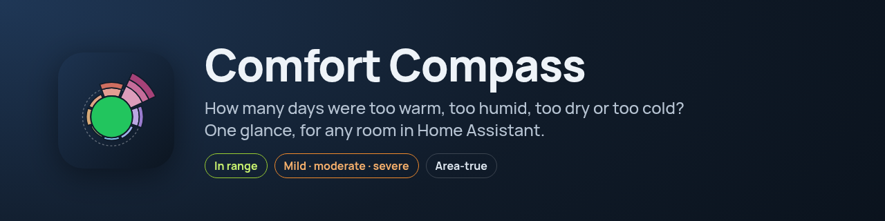
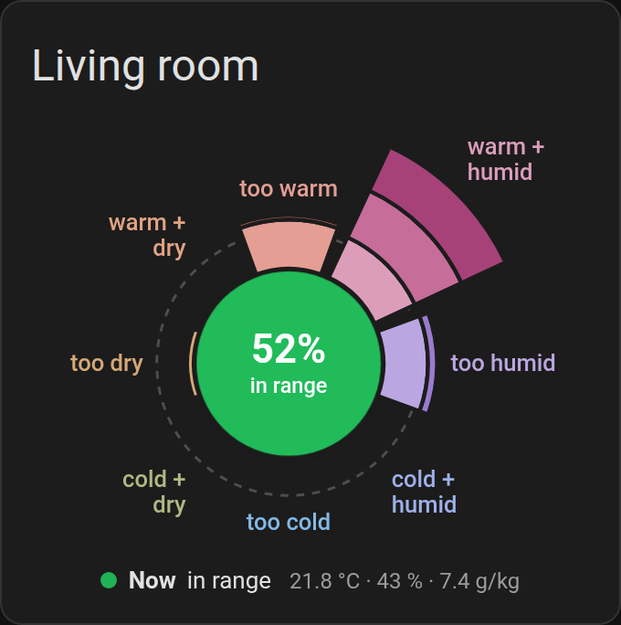
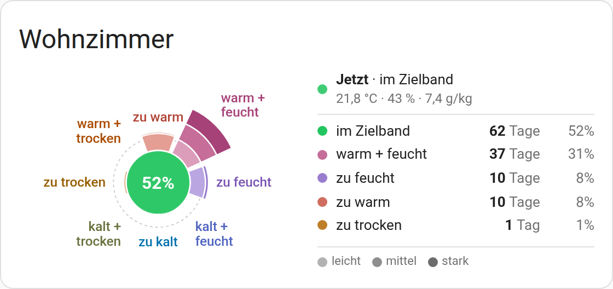
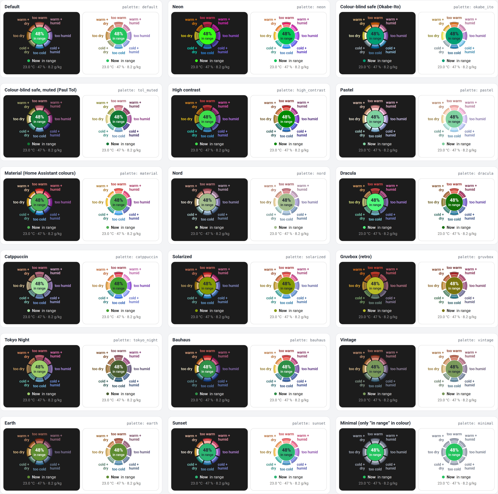

<p align="center">
  
</p>

<p align="center">
  <a href="https://github.com/retomarek/comfort-compass-card/releases"></a>
  <a href="https://github.com/hacs/integration"></a>
  
  <a href="https://github.com/retomarek/comfort-compass-card/actions/workflows/validate.yaml"></a>
  <a href="https://github.com/retomarek/comfort-compass-card/releases"></a>
  <a href="https://retomarek.github.io/mollier-hx-card/"></a>
  <a href="LICENSE"></a>
</p>

<p align="center">
  <a href="https://my.home-assistant.io/redirect/hacs_repository/?owner=retomarek&repository=comfort-compass-card&category=plugin"></a>
</p>

<p align="center">How many days were too warm, too humid, too dry or too cold? One glance, for any room in Home Assistant.</p>

<p align="center">
  
  
</p>

The card takes the daily means of a temperature and a humidity sensor and compares every day with your comfort zone. The dashed circle stands for all days. The green disc is the share of days in range; each of the eight arms is the share of days that were off in one direction: too warm, too humid, too dry, too cold, or a mix of two. Disc and arms together always have the area of the dashed circle. Each arm is split into mild, moderate and severe, from the inside out.

**[▶ Try it in the live demo](https://retomarek.github.io/mollier-hx-card/)**: both cards side by side, with sample rooms, sliders for the comfort zone and the live reading, themes, languages and palettes, and the YAML to copy.

> **Sister card: [Mollier hx Card](https://github.com/retomarek/mollier-hx-card)** draws the same days on an h,x diagram, with the same comfort zone and warning bands. The compass shows *how often*, the diagram *where* and *why*. Both are ports from [pyedautils](https://github.com/retomarek/pyedautils) (`pip install pyedautils`), so the same analysis works in Python or Jupyter.

## Features

- **Area-true**: disc and arms together always have the area of the dashed 100 % circle, so the picture does not exaggerate.
- **Reads like an h,x diagram**: warm at the top, cold at the bottom, humid on the right, dry on the left.
- **Severity from warning bands**: mild, moderate and severe; relative **and** absolute humidity count.
- **Shows where you are now**: the segment of the live reading slowly breathes, and a "Now" line gives the values.
- **Hover or tap** a segment for its days and share; optional legend.
- **Fits any dashboard**: capped and centred at full width, fills a tile with a fixed height.
- **18 colour palettes**, colour-blind safe and high-contrast ones included; follows your light or dark theme.
- **14 languages** and a **visual editor** that only lists sensors with long-term statistics.

## Installation

From Home Assistant 2026.11 on, community cards come from the built-in **Marketplace** (*Settings → Marketplace*). On older versions use **HACS**. Both use the same catalog.

1. Open the link above, or search for **Comfort Compass Card**.
   - Not listed yet? Marketplace: *Add from link* with `https://github.com/retomarek/comfort-compass-card`. HACS: three-dot menu → *Custom repositories*, type *Dashboard*.
2. Install it. The dashboard resource is added for you.
3. Reload the browser.

**Requirement:** both sensors need long-term statistics, which means `state_class: measurement`. Most temperature and humidity sensors already have it. The visual editor only lists sensors that qualify.

## Configuration

Add a card, pick **Comfort compass card** and fill in the form. Or use YAML:

```yaml
type: custom:comfort-compass-card
temperature_entity: sensor.living_room_temperature
humidity_entity: sensor.living_room_humidity
title: Living room
days_to_show: 90
```

### Options

| Option | Type | Default | Description |
| --- | --- | --- | --- |
| `temperature_entity` | string | | **Required.** Temperature sensor. |
| `humidity_entity` | string | | **Required.** Relative-humidity sensor in %. |
| `title` | string | | Card title. |
| `days_to_show` | number | `30` | Completed days to count, 1 to 3650 (daily statistics are kept indefinitely). |
| `comfort_zone` | object | 20–26 °C, 30–65 %, 0–12 g/kg | See [below](#comfort-zone-and-warning-bands). Temperatures always in °C. |
| `warning_bands` | `true` \| object | `true` (defaults) | Limits for mild and moderate, see [below](#comfort-zone-and-warning-bands). |
| `altitude` | number | | Altitude in m above sea level (-500 to 9000), for the absolute humidity. Overrides `pressure`. |
| `pressure` | number | `101325` | Air pressure in hPa (300–1100) or Pa (30000–110000). |
| `show_legend` | boolean | `false` | List the directions with days and share. Beside the compass when the card is wide, below it otherwise. |
| `show_labels` | boolean | `true` | Name the eight directions around the compass. |
| `show_current` | boolean | `true` | Mark the live reading: the matching segment slowly breathes (a small dot when no day fell into that state yet). No animation with reduced motion. |
| `show_current_legend` | boolean | `true` | Show the "Now" line with the live state and values. Independent of the marker; left out in very small tiles. |
| `palette` | string | `default` | Colour palette, see [Colour palettes](#colour-palettes). |
| `breathing` | number | `55` | How strongly the live segment breathes, 10 (barely) to 90 %. Needs `show_current`. |
| `scale` | `fit` \| `fixed` | `fit` | `fit` fills the card; `fixed` keeps the 100 % circle the same size in every card, see [Comparing rooms](#comparing-rooms). |

<details>
<summary>Invalid values and reduced motion</summary>

Invalid values (an unknown `scale`, a `comfort_zone` without a `[min, max]` pair for temperature or humidity, `days_to_show` below 1, a pressure or altitude outside the ranges above) give a clear error message instead of a wrong compass. Longer periods than 3650 days are cut to 3650.

**Reduced motion** switches the breathing off: iOS/iPadOS *Settings → Accessibility → Motion → Reduce Motion*; macOS *System Settings → Accessibility → Display → Reduce motion*; Windows *Settings → Accessibility → Visual effects → Animation effects*; Android *Settings → Accessibility → Remove animations*.

</details>

### Comfort zone and warning bands

Defaults: 20–26 °C, 30–65 %, at most 12 g/kg. A `comfort_zone` of your own without `absolute_humidity` has no 12 g/kg limit: humidity is then judged by relative humidity only. Warning bands orange ±1 K / 5 % / 1 g/kg (mild), red ±2.5 K / 10 % / 2.5 g/kg (moderate), severe beyond. The Mollier hx Card takes the same keys.

<details>
<summary>YAML and details</summary>

#### `comfort_zone`

```yaml
comfort_zone:
  temperature: [20, 26]        # °C
  humidity: [30, 65]           # % relative humidity
  absolute_humidity: [0, 12]   # g/kg
```

A day is *in range* when all three hold. A humid day is one above the relative **or** the absolute limit, so a warm day above 12 g/kg counts as warm and humid even if its relative humidity is fine.

Temperatures are always in °C, also with Fahrenheit sensors (the statistics are converted to °C). A zone that looks like °F (upper limit above 45) shows a hint on the card.

Without `comfort_zone` the defaults above apply. If you give a `comfort_zone`, `temperature` and `humidity` are required; `absolute_humidity` is optional, and without it there is no absolute limit: humidity is then judged by relative humidity only.

#### `warning_bands`

± offsets around the comfort zone that separate the severity stages: temperature in K, relative humidity in %-points, absolute humidity in g/kg. `true` (or leaving it out) uses the defaults; the compass always needs stages, so `false` also means the defaults. Each band and each value is optional.

```yaml
warning_bands:
  orange: { temperature: 1, humidity: 5, absolute_humidity: 1 }        # mild up to here
  red: { temperature: 2.5, humidity: 10, absolute_humidity: 2.5 }      # moderate up to here, severe beyond
```

These are the defaults. The worse of temperature and humidity decides the stage. `color` and `label` per band are accepted for compatibility with the Mollier hx Card but have no effect here. The [Mollier hx Card](https://github.com/retomarek/mollier-hx-card) takes the same `comfort_zone` and `warning_bands` and draws them as zone and dashed bands.

</details>

### Size in the dashboard

In a sections dashboard the card takes half the width and sets its own height; next to a taller card in the same row it grows to match, with the compass centred. The compass is at most 340 px wide, also at full width. Set a row count under *Layout* to give it a fixed height; the compass then fits the tile. With `scale: fixed` the direction labels stay at the edges like on a compass rose, so every card has the same frame; in narrow cards a label beside a long arm gets smaller, and in very narrow ones the labels are left out (hover shows the direction).

## Reading the compass

The dashed circle is **100 % of the days**; the green disc and the arms always add up to exactly that area. Hover or tap a segment for its days; the breathing segment is *now*.

<details>
<summary>How to read it</summary>

> **More in the pyedautils guide.** [Reading the comfort compass](https://retomarek.github.io/pyedautils/guides/comfort_compass.html) explains the compass step by step, with worked examples computed with pyedautils: [reading the compass](https://retomarek.github.io/pyedautils/guides/comfort_compass.html#compass-reading-the-diagram), [comfort](https://retomarek.github.io/pyedautils/guides/comfort_compass.html#compass-comfort), [saving energy](https://retomarek.github.io/pyedautils/guides/comfort_compass.html#compass-saving-energy).

The dashed circle is the area of **100 % of the days**. The green disc and the arms always add up to exactly that area:

- All days in range: the green disc fills the dashed circle exactly, and there are no arms.
- Some days off: the disc shrinks by the share of those days, and the same area reappears in the arms. A long arm is therefore not "more than 100 %"; it is area moved out of the disc.
- Each arm points in the direction of the deviation (warm up, cold down, humid right, dry left, mixes diagonal). From the inside out its segments are mild, moderate and severe, each with an area equal to its share of days.

Hover or tap a segment for the number of days and its share.

The segment that slowly breathes is where the room is **right now**: the live temperature and humidity are sorted into the same directions and stages as the daily means. If no day has been in that state yet, a small dot at the start of that arm marks it. The "Now" line names the state and the current values.

</details>

## Comparing rooms

Every compass is zoomed to fill its card, so compare rooms by their percentages, or set `scale: fixed` on all of them to compare by area.

<details>
<summary>Details and example</summary>

By default (`scale: fit`) every compass is zoomed to its own glyph, so it fills the card. The dashed circle then has a different size in each card, and **two compasses cannot be compared by area**, only by their percentages.

To compare rooms, set `scale: fixed` on all of them (in the editor: *Display → Fixed scale*). The scale is then fixed to the largest possible arm, so the dashed 100 % circle is the same size in every card, and equal areas mean equal numbers of days. Give the cards the same width (for example the same number of columns) so they are drawn at the same size. With mostly good days the glyph is smaller in this mode.

```yaml
type: custom:comfort-compass-card
temperature_entity: sensor.bedroom_temperature
humidity_entity: sensor.bedroom_humidity
title: Bedroom
scale: fixed
```

</details>

## Colour palettes

Pick one under *Display → Colour palette*, or `palette: okabe_ito` in YAML. Every palette keeps the meaning of the compass; several switch with your light or dark theme.

<p align="center">
  
</p>

<details>
<summary>All palettes</summary>

Every palette keeps the meaning of the compass: warm is reddish at the top, cold bluish at the bottom, humid on the right, dry on the left, and the centre colour for *in range* stands out. Each direction gets one base colour; the card derives mild, moderate and severe from it (same hue, stepped lightness), so the severity always reads as a ramp. Palettes marked *dark / light* switch automatically with your Home Assistant theme: on dark themes they glow (mild dim, severe bright), on light themes they use deeper tones. Direction labels are darkened or lightened when needed so they stay readable (WCAG AA contrast against Home Assistant's default card backgrounds; very unusual theme colours can still lower it).

The overview is rendered from the real card on every code push to `main` (`npm run screenshots`), so it always matches the current palettes.

| `palette` | Style | Theme | Notes |
| --- | --- | --- | --- |
| `default` | soft, clear | both | The original look. |
| `neon` | glowing | dark / light | Bright neon on dark cards, deep saturated colours on light ones. |
| `okabe_ito` | colour-blind safe | both | Based on the Okabe & Ito palette, the standard for colour-vision deficiencies; two neutral tones fill the gaps. |
| `tol_muted` | colour-blind safe, calm | both | Paul Tol's *muted* scheme. |
| `high_contrast` | strong | dark / light | Clearly separated colours with high contrast, for low vision or bright rooms. |
| `pastel` | soft pastels | both | Chalk on paper. |
| `material` | Home Assistant | both | Material Design colours, the same named colours as Home Assistant's tile cards and Mushroom. |
| `nord` | arctic, muted | both | Nord's frost blues and aurora colours. |
| `dracula` | dark classic | dark / light | Dracula on dark themes, Alucard on light ones. |
| `catppuccin` | pastel, modern | dark / light | Mocha on dark themes, Latte on light ones. |
| `solarized` | classic | both | Solarized accent colours. |
| `gruvbox` | retro | dark / light | Warm retro colours. |
| `tokyo_night` | night | dark / light | Deep night blue with neon accents. |
| `bauhaus` | design classic | both | Primary red, yellow and blue. |
| `vintage` | old-fashioned | both | Faded print colours, like an old atlas. |
| `earth` | natural | both | Forest, clay, sand and lake. |
| `sunset` | warm, cheerful | both | Coral, rose and violet over a cool sea. |
| `minimal` | calm | both | Only *in range* in colour, every deviation in neutral grey; the labels name the directions. |

The colours of `nord`, `dracula`, `catppuccin`, `solarized`, `gruvbox` and `tokyo_night` are taken from the open-source colour schemes of the same name (all MIT licensed), so the card matches the popular Home Assistant themes built on them. Missing your favourite? Open a [feature request](https://github.com/retomarek/comfort-compass-card/issues/new/choose); a new palette is one entry in [`src/palettes.js`](src/palettes.js).

</details>

## Why temperature and humidity belong together

Relative humidity changes with temperature, so the compass judges every day on both together: a day is *in range* only when both are.

<details>
<summary>Why it matters, with numbers</summary>

Comfort, health and the risk of mould always depend on temperature **and** humidity at the same time. Looking at one of them alone, or at two separate graphs, can easily mislead:

- **Relative humidity changes with temperature.** Air at 21 °C and 60 % holds about 9.8 g of water per kg (at 450 m a.s.l.). Warm the same air to 26 °C and it reads only 44 %; cool it at a 15 °C outer wall and it reaches about 87 %, enough for mould. The amount of water did not change at all.
- **The same reading means different things.** 23 °C feels pleasant at 45 %, but sticky at 70 %.

That is why the compass judges every day on both together: a day only counts as *in range* when temperature and humidity are both in the comfort zone, and the direction of an arm tells you which combination was off. *Warm + humid* calls for cooling or ventilation, *cold + humid* points to condensation and mould risk, *warm + dry* to overheated, dry winter air.

</details>

## Good for people and the environment

What the arms mean for comfort, mould and the heating bill, and what to do about them.

<details>
<summary>Examples</summary>

The h,x diagram behind this card explains why the compass looks the way it does, and what you can do about it:

- **Too dry in winter** (left arms) usually comes from ventilating with cold outside air: at 0 °C and 80 % it carries only about 3.2 g/kg of water, which is just **20 %** relative humidity once heated to 21 °C.
- **Heating less** moves days towards *in range*: the water content stays, the relative humidity rises. Air with 6.4 g/kg reads about 35 % at 23 °C, but 40 % at 21 °C. As a rule of thumb, every degree less saves around **6 % of heating energy**, good for comfort, the bill and the climate.
- **Too humid or cold + humid** (right and lower right arms) means a risk of condensation and mould at cold surfaces: at 21 °C and 60 %, the dew point is 12.9 °C, and mould can grow on surfaces below about 16 °C, such as outside wall corners in winter. Short, wide-open airing helps, as long as the outside air is drier than the room air.

The [Mollier hx Card README](https://github.com/retomarek/mollier-hx-card#the-hx-diagram-in-five-minutes) explains the h,x diagram step by step, with these examples, and the pyedautils guide [The h,x diagram in five minutes](https://retomarek.github.io/pyedautils/guides/mollier_hx.html) goes deeper ([saving energy](https://retomarek.github.io/pyedautils/guides/mollier_hx.html#hx-saving-energy)); more background on [Wikipedia](https://en.wikipedia.org/wiki/Psychrometrics#Mollier_diagram). The two cards work well side by side: the diagram shows *where* each day was, the compass *how often*.

</details>

## Translations

The card follows the language of your Home Assistant profile. Anything not translated falls back to English. English and German are written by the author, the other 12 languages are machine-translated, so corrections are very welcome.

<details>
<summary>Languages and how to help</summary>

| Language | Status |
| --- | --- |
| English, German | written by the author |
| French, Italian, Spanish, Portuguese, Dutch, Polish, Swedish, Danish, Norwegian, Czech, Russian, Chinese (Simplified) | machine-translated, not yet checked by a native speaker |

**Something reads wrong in your language? Please open a pull request.** Edit the file for your language in [`src/localize/languages/`](src/localize/languages/) directly on GitHub (pencil icon → *Propose changes*); a short note on what you changed is enough. If you'd rather not touch the file, open a [translation issue](https://github.com/retomarek/comfort-compass-card/issues/new?template=translation.yml) instead.

To add a new language, copy [`en.json`](src/localize/languages/en.json) to `<language code>.json`, translate the values and register the file in [`src/localize/localize.js`](src/localize/localize.js). See [CONTRIBUTING.md](CONTRIBUTING.md).

</details>

## How it works

<details>
<summary>Data source and related projects</summary>

Daily means come from Home Assistant's `recorder/statistics_during_period` WebSocket API. The classification is a port of `pyedautils.comfort.comfort_compass_distribution` and the glyph of `pyedautils.plots.comfort.plot_comfort_compass` from [pyedautils](https://github.com/retomarek/pyedautils). Absolute humidity uses the pyedautils psychrometric functions (`data/d3_mollierhx/mollierFunctions.js`), the same as the Mollier hx Card.

**Related projects**

- [d3-mollierhx](https://github.com/hslu-ige-laes/d3-mollierhx): the interactive Mollier h,x diagram for the browser, built on D3.js ([live demo](https://hslu-ige-laes.github.io/d3-mollierhx/)).
- [pyedautils](https://github.com/retomarek/pyedautils): Python Energy Data Analysis Utilities, with the h,x diagram (`plot_mollier_hx`), the comfort compass (`plot_comfort_compass`) and [guides on reading them](https://retomarek.github.io/pyedautils/guides/) (`pip install pyedautils`).
- [EDAP: Energy Data Analysis with Python](https://github.com/retomarek/edap): an interactive online book on analysing and visualising energy and comfort time series with pandas, Plotly and pyedautils ([read the book](https://retomarek.github.io/edap/intro.html)).
- [Mollier hx Card](https://github.com/retomarek/mollier-hx-card): the h,x diagram as a Home Assistant dashboard card, with outside air and ventilation line.

</details>

## Questions and feedback

- **Questions or ideas?** Ask in [Q&A](https://github.com/retomarek/comfort-compass-card/discussions/categories/q-a).
- **Found a bug or want a feature?** Open an [issue](https://github.com/retomarek/comfort-compass-card/issues/new/choose).
- **Translation wrong?** See [Translations](#translations): a small pull request is the quickest fix.
- **Find it useful?** A star on GitHub helps others find it.

## Credits

- [pyedautils](https://github.com/retomarek/pyedautils), Python Energy Data Analysis Utilities: classification, glyph design and psychrometric functions.

## License

MIT © Reto Marek, see [LICENSE](LICENSE).
